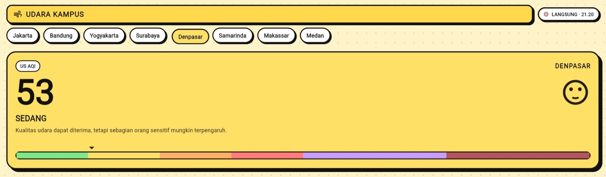
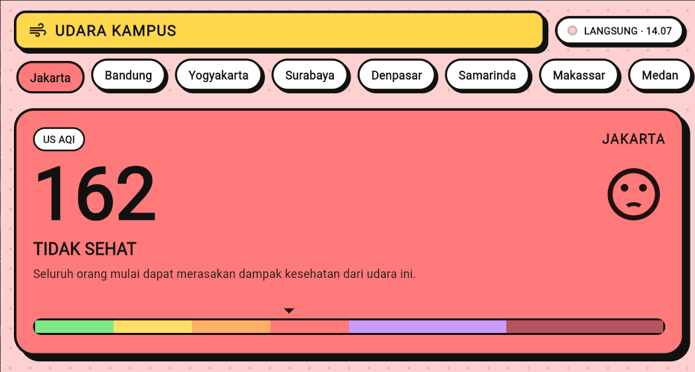
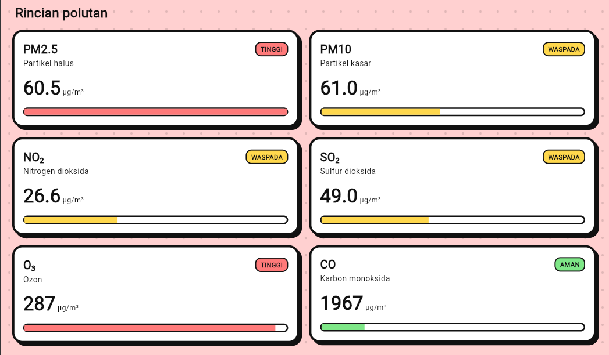
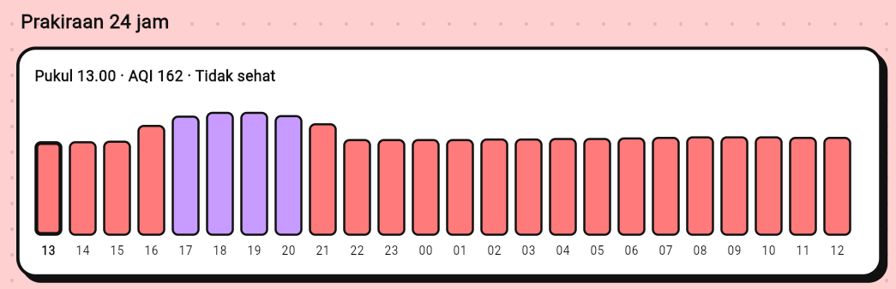
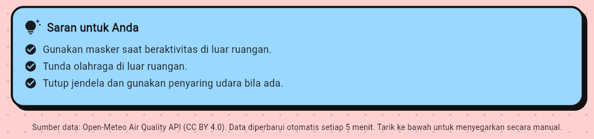
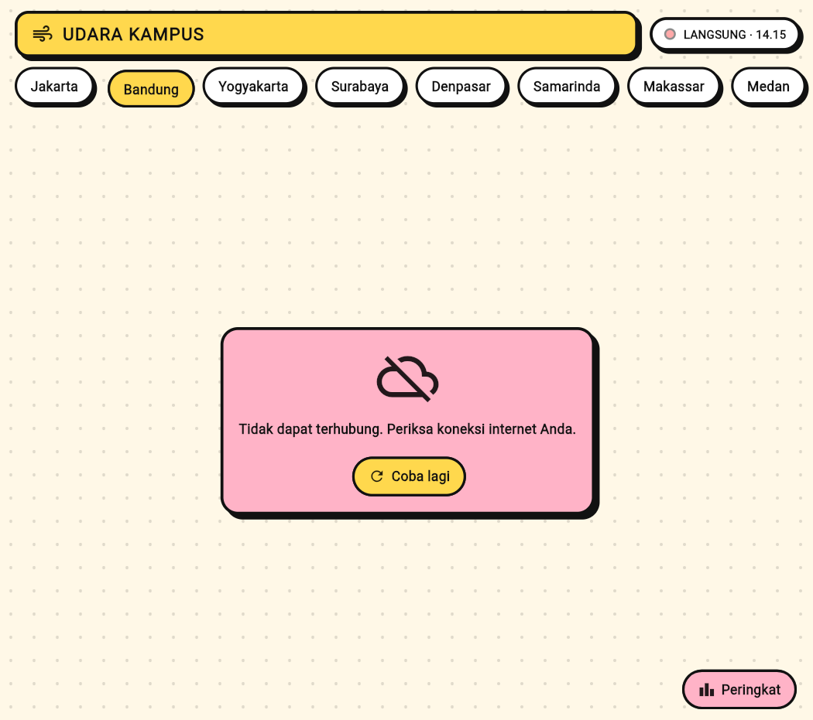
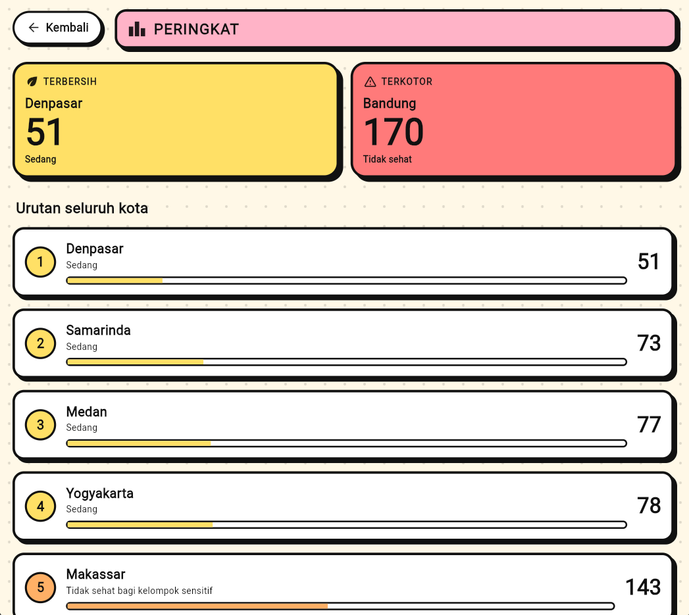
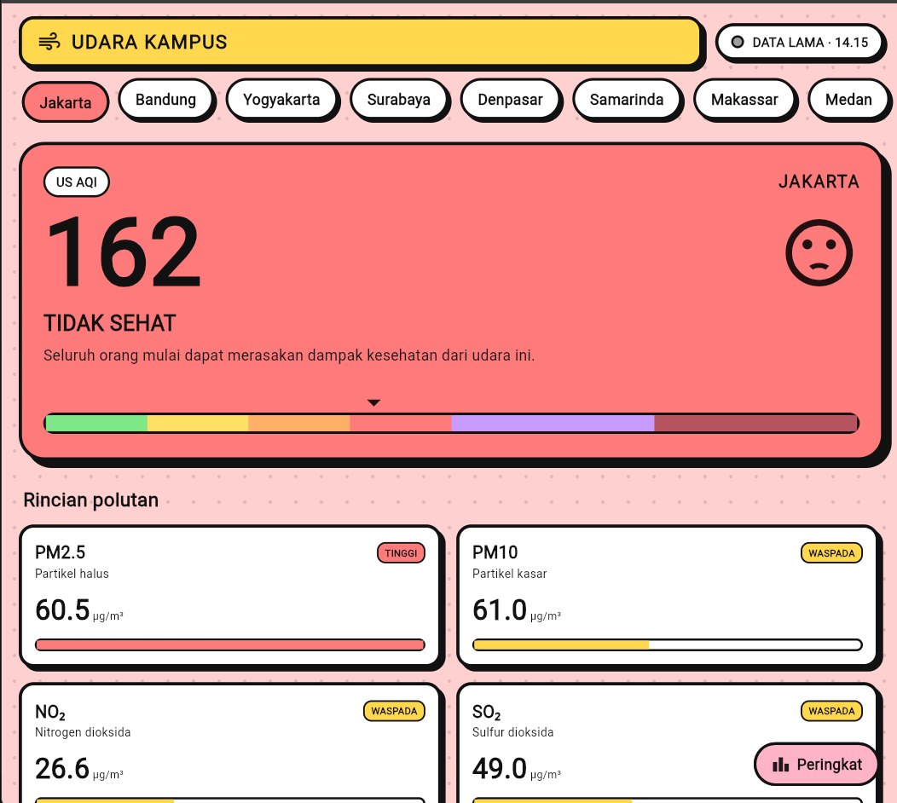

# Udara Kampus

Aplikasi Flutter untuk memantau kualitas udara di delapan kota kampus secara langsung. Aplikasi ini dikembangkan dari contoh "Cuaca Kampus" (Pertemuan 10, Pemrograman Piranti Bergerak: Asinkron dan REST API). Pola MVVM dan cara kerja layanan HTTP dari contoh tersebut tetap dipertahankan, sedangkan data, model, dan tampilannya diganti agar menampilkan kualitas udara.

## Identitas Kelompok

| No  | Nama                         | NIM        |
| --- | ---------------------------- | ---------- |
| 1   | Rusdianysah                  | 2409106013 |
| 2   | Elfin Sinaga                 | 2409106024 |
| 3   | Akhmad Zifa Al-Fatih         | 2409106025 |
| 4   | Muhammad Naufal Rifyan Ilham | 2409106034 |
| 5   | Rangga Lawe                  | 2409106043 |

Mata kuliah: Pemrograman Piranti Bergerak
Dosen pengampu: Anton Prafanto, S.Kom., M.T
Kelas: A'24

## Deskripsi Aplikasi

Udara Kampus menampilkan indeks kualitas udara (US AQI) dan kadar enam polutan utama untuk kota yang dipilih. Pengguna dapat berpindah antarkota dengan satu ketukan, melihat perkiraan AQI untuk 24 jam ke depan, dan membaca saran kesehatan yang sesuai dengan kondisi udara saat itu.

### Fitur

1. **Pemantauan langsung.** Data diperbarui otomatis setiap 5 menit. Pengguna juga dapat menarik layar ke bawah untuk memperbarui secara manual.
2. **Indeks AQI dan kategorinya.** Nilai AQI ditampilkan besar beserta kategori (Baik sampai Berbahaya), ikon ekspresi, dan skala warna berpenunjuk.
3. **Rincian polutan.** PM2.5, PM10, NO₂, SO₂, O₃, dan CO ditampilkan lengkap dengan perbandingan terhadap batas pedoman WHO.
4. **Prakiraan 24 jam.** Grafik batang per jam yang dapat diketuk untuk melihat nilai AQI pada jam tertentu.
5. **Saran kesehatan.** Anjuran aktivitas yang berubah mengikuti kategori udara.
6. **Peringkat kota.** Halaman khusus yang membandingkan kedelapan kota dan mengurutkannya dari udara terbersih hingga terkotor. Ketuk sebuah kota untuk langsung melihat rinciannya.
7. **Mengingat kota terakhir.** Kota yang dipilih terakhir dibuka kembali otomatis saat aplikasi dijalankan.
8. **Mode offline.** Data terakhir tiap kota disimpan di perangkat. Saat tidak ada koneksi, data tersebut ditampilkan dengan penanda "DATA LAMA" beserta waktunya.
9. **Penanganan galat.** Gangguan jaringan, waktu tunggu habis, dan kesalahan server ditampilkan dengan pesan yang mudah dipahami beserta tombol "Coba lagi". Rinciannya ada pada bagian Penanganan Galat.

### Tangkapan Layar

|                    Beranda (udara baik)                    |                   Beranda (udara tidak sehat)                    |             Rincian polutan              |
| :--------------------------------------------------------: | :--------------------------------------------------------------: | :--------------------------------------: |
|  |  |  |

|               Prakiraan 24 jam               |           Saran kesehatan            |            Tampilan galat            |
| :------------------------------------------: | :----------------------------------: | :----------------------------------: |
|  |  |  |

|                Peringkat kota                |           Data lama (offline)            |
| :------------------------------------------: | :--------------------------------------: |
|  |  |

## Konsep Desain

Antarmuka memakai gaya **Neo-Brutalism versi lembut (soft dan playful)**. Ciri utamanya:

- garis tepi hitam tebal dan bayangan keras tanpa blur pada setiap kartu;
- warna pastel yang mengikuti skala warna AQI;
- sudut membulat dan ikon ekspresi agar terasa ramah;
- latar berpola titik-titik.

Gaya ini dipilih karena kontrasnya tinggi sehingga angka mudah dibaca, dan warna-warna pastelnya sejalan dengan skala AQI yang memang berbasis warna.

Bagian yang bersifat dinamis:

- warna latar halaman dan warna aksen berganti halus sesuai kategori udara kota yang dipilih;
- angka AQI berhitung naik dan penunjuk skala bergeser dengan animasi;
- kartu muncul satu per satu saat data selesai dimuat;
- tombol kota "tenggelam" saat ditekan;
- penanda LANGSUNG berkedip beserta jam pembaruan terakhir.

## Sumber Data

Data diambil dari [Open-Meteo Air Quality API](https://open-meteo.com/en/docs/air-quality-api) yang gratis dan tidak memerlukan kunci API. Penyedia yang sama dipakai pada contoh Cuaca Kampus, sehingga struktur pemanggilannya tetap mirip. Data berlisensi CC BY 4.0 dan atribusinya dicantumkan di bagian bawah aplikasi.

Contoh permintaan:

```
GET https://air-quality-api.open-meteo.com/v1/air-quality
    ?latitude=-0.5&longitude=117.15
    &current=us_aqi,pm2_5,pm10,carbon_monoxide,nitrogen_dioxide,sulphur_dioxide,ozone
    &hourly=us_aqi
    &forecast_hours=24
    &timezone=auto
```

Kategori AQI mengikuti standar US EPA: 0–50 Baik, 51–100 Sedang, 101–150 Tidak sehat bagi kelompok sensitif, 151–200 Tidak sehat, 201–300 Sangat tidak sehat, dan di atas 300 Berbahaya. Batas pembanding polutan memakai pedoman kualitas udara WHO 2021 (rata-rata 24 jam, sedangkan ozon rata-rata 8 jam) dan hanya berfungsi sebagai acuan visual, bukan penilaian medis.

## Struktur Folder

```
udara_kampus/
├── lib/
│   ├── main.dart                     # titik masuk dan pendaftaran Provider
│   ├── app.dart                      # MaterialApp dan tema
│   ├── core/
│   │   ├── konstanta/kota.dart       # daftar kota dan koordinatnya
│   │   ├── tema/warna_brutal.dart    # palet warna
│   │   └── utils/format.dart         # fungsi pemformat angka
│   ├── data/
│   │   ├── models/                   # Udara, Polutan, KategoriAqi
│   │   ├── services/
│   │   │   ├── layanan_udara.dart       # HTTP, kode status, batas waktu, percobaan ulang
│   │   │   └── penyimpanan_lokal.dart   # kota terakhir dan cache (shared_preferences)
│   │   └── repositories/repositori_udara.dart   # JSON menjadi model, simpan dan baca cache
│   ├── viewmodels/
│   │   ├── udara_view_model.dart        # status, kota terpilih, pembaruan berkala
│   │   └── peringkat_view_model.dart    # pengambilan paralel dan pengurutan kota
│   └── views/
│       ├── halaman/
│       │   ├── halaman_udara.dart       # halaman utama
│       │   └── halaman_peringkat.dart   # halaman peringkat kota
│       └── widgets/                     # komponen tampilan
├── test/udara_test.dart              # pengujian tanpa internet
├── docs/screenshots/                 # tangkapan layar untuk README
├── pubspec.yaml
└── README.md
```

Alur data mengikuti pola MVVM: `Layanan` mengambil JSON, `Repositori` mengubahnya menjadi model, `ViewModel` mengelola status dan memberi tahu tampilan, lalu `View` menampilkan hasilnya. Setiap lapisan hanya mengenal satu lapisan di bawahnya, sehingga mudah diuji dan diganti. Misalnya, bila kelompok ingin berpindah ke OpenWeather, cukup mengganti isi layanan dan repositori tanpa mengubah tampilan.

## Cara Menjalankan

Prasyarat: Flutter SDK 3.19 atau lebih baru dan koneksi internet.

```bash
# 1. Buat kerangka platform di dalam folder proyek (sekali saja)
flutter create --project-name udara_kampus .

# 2. Pasang dependensi
flutter pub get

# 3. Jalankan aplikasi
flutter run -d chrome        # atau pilih emulator / perangkat Android
```

Untuk membangun APK pada Android, pastikan izin internet tercantum di `android/app/src/main/AndroidManifest.xml`:

```xml
<uses-permission android:name="android.permission.INTERNET"/>
```

Kemudian jalankan `flutter build apk --release`. Berkas hasilnya berada di `build/app/outputs/flutter-apk/app-release.apk`.

## Penanganan Galat

| Situasi                                                             | Penanganan                                                                                                                                                    |
| ------------------------------------------------------------------- | ------------------------------------------------------------------------------------------------------------------------------------------------------------- |
| Koneksi terputus, waktu tunggu habis, atau server menjawab kode 5xx | Permintaan diulang otomatis hingga 3 kali dengan jeda yang makin lama.                                                                                        |
| Kode 400 atau kode 4xx lainnya                                      | Tidak diulang karena hasilnya akan sama. Pesan ditampilkan kepada pengguna.                                                                                   |
| Kode 429 (terlalu banyak permintaan)                                | Tidak diulang; pengguna diminta menunggu sebentar.                                                                                                            |
| Isi respons bukan JSON, atau server menandai `error: true`          | Diubah menjadi `FormatException` dengan pesan "Data dari server tidak dapat dibaca".                                                                          |
| Tipe data tidak sesuai, nilai negatif, atau nilai kosong            | Kadar polutan yang tidak valid ditampilkan sebagai "-" (status N/A). Data per jam yang rusak dilewati tanpa menggagalkan seluruh grafik.                      |
| AQI tidak ada pada respons                                          | Dianggap gagal total karena nilai utama tidak dapat ditampilkan.                                                                                              |
| Koordinat kota di luar rentang                                      | Ditolak sebelum permintaan dikirim.                                                                                                                           |
| Tidak ada koneksi saat aplikasi dibuka                              | Data tersimpan dari penyimpanan lokal ditampilkan dan ditandai "DATA LAMA". Bila belum ada data tersimpan, ditampilkan pesan galat dengan tombol "Coba lagi". |
| Penyimpanan lokal gagal dibaca atau ditulis, atau isinya rusak      | Diabaikan tanpa menghentikan aplikasi; data rusak diperlakukan seperti tidak ada.                                                                             |
| Satu atau beberapa kota gagal dimuat pada halaman peringkat         | Kota lain tetap ditampilkan. Kota yang gagal memakai data tersimpan, atau ditandai "Data tidak tersedia" dan diletakkan di urutan akhir.                      |
| Pembaruan otomatis atau tarik-untuk-menyegarkan gagal               | Data lama tetap ditampilkan dan ditandai "DATA LAMA". Pada penyegaran manual, pengguna juga diberi tahu lewat SnackBar.                                       |
| Jawaban lama tiba setelah pengguna berganti kota                    | Diabaikan menggunakan nomor permintaan.                                                                                                                       |
| Jawaban tiba setelah layar ditutup                                  | Diabaikan agar tidak terjadi pembaruan pada objek yang sudah dibuang.                                                                                         |

## Pengujian

```bash
flutter test
```

Pengujian memakai `MockClient` sehingga tidak memerlukan internet. Yang diperiksa antara lain batas kategori AQI, pembacaan JSON (termasuk nilai `null`, nilai negatif, dan data per jam yang kosong), percobaan ulang pada kode 500, tidak adanya percobaan ulang pada kode 400, penolakan koordinat tidak valid, perilaku ViewModel saat penyegaran gagal, penyimpanan dan pemulihan cache, pemulihan kota terakhir, serta pengurutan dan penanganan kota gagal pada peringkat.

## Cara Kerja Fitur Peringkat dan Penyimpanan

**Peringkat.** `PeringkatViewModel` mengirim delapan permintaan sekaligus menggunakan `Future.wait`, sehingga waktu tunggunya mendekati waktu satu permintaan terlama, bukan delapan kali waktu satu permintaan. Setiap permintaan dibungkus agar tidak melempar galat; satu kota yang gagal tidak membatalkan kota lainnya. Hasilnya diurutkan menurut AQI, dan bila nilainya sama diurutkan menurut abjad.

**Penyimpanan lokal.** Dua jenis data disimpan dengan `shared_preferences`:

1. nama kota yang terakhir dipilih;
2. JSON terakhir dari server untuk tiap kota, beserta waktu pengambilannya.

Data hanya disimpan setelah berhasil dibaca dan divalidasi, sehingga cache tidak berisi data rusak. Cache dibaca hanya ketika pengambilan dari server gagal. Seluruh operasi penyimpanan dibungkus penanganan galat, jadi kegagalan membaca atau menulis tidak mengganggu fungsi utama aplikasi.

## Cara Menambah Kota

Buka `lib/core/konstanta/kota.dart`, lalu tambahkan satu baris pada `enum Kota`:

```dart
balikpapan('Balikpapan', -1.24, 116.85),
```

## Keterbatasan

- Data berasal dari model prakiraan global sehingga dapat berbeda dari pembacaan alat ukur di lokasi tertentu.
- Aplikasi membutuhkan koneksi internet untuk data terbaru. Tanpa koneksi, hanya data tersimpan terakhir yang dapat ditampilkan, termasuk prakiraan per jam yang mungkin sudah lewat.
- Prakiraan per jam hanya mencakup AQI, bukan tiap polutan.

## Pembagian Tugas

| Anggota | Tanggung jawab                                                   |
| ------- | ---------------------------------------------------------------- |
| 1       | Layanan dan repositori (pemanggilan API, parsing JSON)           |
| 2       | ViewModel dan penanganan galat                                   |
| 3       | Desain tampilan: kartu AQI dan skala warna                       |
| 4       | Desain tampilan: polutan, grafik, animasi, dan halaman peringkat |
| 5       | Penyimpanan lokal, pengujian, dokumentasi, dan tangkapan layar   |

(Sesuaikan dengan pembagian tugas kelompok yang sebenarnya.)

## Referensi

- Contoh "Cuaca Kampus", Pemrograman Piranti Bergerak, Pertemuan 10 (repositori dosen pengampu).
- Open-Meteo Air Quality API: https://open-meteo.com/en/docs/air-quality-api
- US EPA, Air Quality Index (AQI) Basics: https://www.airnow.gov/aqi/aqi-basics/
- WHO Global Air Quality Guidelines 2021.
